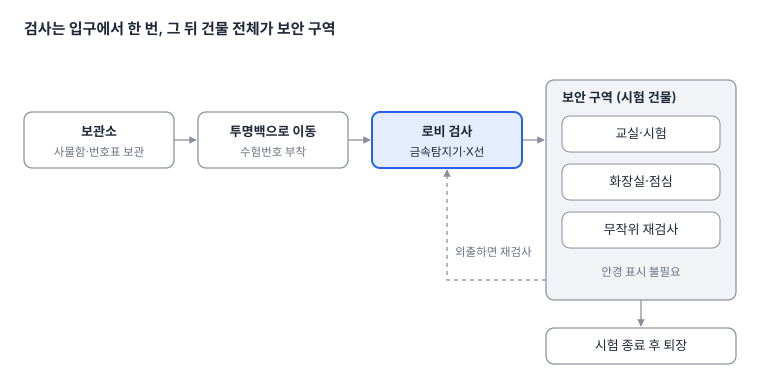

# 대학 입학시험 부정행위 방지를 위한 제로 아이템(Zero-Item) 보안 프로토콜(안)

Nov 26, 2026

## 요약

| 항목 | 내용 |
| --- | --- |
| 목적 | 전자기기를 이용한 입시 부정행위에 대해, 시험장·감독관과 관계없이 모든 수험생에게 균일한 품질의 감독을 제도로 보장함 |
| 핵심 방식 | 시험 건물을 "보안 구역"으로 지정하고, 입구에서 1회 검사(X선·문형 금속탐지기) 후 시험 종료까지 미검사 물품의 반입을 차단함 |
| 적용 방식 | 시험장 여건에 따라 레벨 1\~3 중 선택 (일본 교육 당국의 권장 기준 + 대학 자가진단) |
| 소요 비용 (예시) | 지원자 5,000명 대학 기준 X선 장비 약 14대 약 5,600만\~6,600만 엔(구매 시), 인건비 시험 1일당 약 240만\~295만 엔 (2026년 11월 기준 개략 추정) |
| 추진 순서 | 시범 운영 → 자가진단 체크리스트 배포 → 장비 공동 대여 체계 구축 → 확대 시행 |
| 기대 효과 | 신체 접촉 검사 없이 부정행위 억지 효과를 높이고, 감독관의 부담을 덜며, 입시 공정성에 대한 국민의 신뢰를 확보함 |

## 왜 "제로 아이템"인가

**부정 기기를 "찾아내는" 방식에서, 검사받지 않은 물건이 "들어오지 못하게 하는" 방식으로 발상을 전환함.**

- 부정 기기는 해마다 작아지고 일상 용품과 구별하기 어려워짐. 시험실 안에서 기기를 찾아내는 방식은 기술 발전을 뒤따라갈 수밖에 없음
- 제로 아이템은 기기가 무엇인지 묻지 않음. **검사를 받지 않은 물건은 하나도 시험 건물에 들어갈 수 없다**는 한 가지 원칙만 지킴
- 따라서 기기가 아무리 작아져도 원칙은 바뀌지 않음

|  | 기존 방식 | 제로 아이템 |
| --- | --- | --- |
| 질문 | "부정 기기를 가지고 있는가?" | "검사를 받은 물건인가?" |
| 시점 | 시험 중, 시험실 안 | 시험 전, 건물 입구 |
| 부담 | 현장 감독관에게 집중 | 입구 시스템이 분담 |
| 기기 소형화 | 탐지가 점점 어려워짐 | 영향이 작음 (단, 신체 은닉 소형 기기는 금속탐지기 성능에 의존) |
| 수험생에게 | 시험장마다 상황이 다를 수 있음 | 어느 시험장이든 같은 기준 |

**현실적 한계:** "검사를 받지 않은 물건은 들어갈 수 없다"는 운영의 **목표 원칙**임. X선 검사는 제출된 물품에만 적용되며, 신체·의복·신발에 은닉한 소형 기기는 문형 금속탐지기의 성능에 의존하므로 완전히 차단한다고 볼 수 없음. 이 틈은 시험 중 대책(제7장)과 감독관의 현장 감독으로 보완함.

**공항 보안과 같은 기본 원리임.** 공항은 탑승구마다 검사하지 않고, 보안 검색대에서 한 번 검사한 뒤 그 안쪽 전체를 깨끗한 구역으로 유지함. 본 프로토콜은 시험 건물을 그 "깨끗한 구역"으로 만드는 것임.

이하의 세부 규정은 모두 이 한 가지 원칙을 현장에서 지키기 위한 방법임.

## 본 문서의 범위

**가. 일본을 예시로 한 사정**

- 작성자의 개인적 경험을 바탕으로, 구체성을 위해 일본의 사례·제도·법령·비용(엔화)을 기준으로 작성함
- 본문에 언급된 법령(소비자계약법, 전파법, 경비업법, 개인정보보호법, 장애인차별해소법 등)과 제도(受験上の配慮 등)는 일본의 것임
- 다른 국가·지역에서 이용하는 경우 해당 지역의 법령·제도·비용에 맞춰 조정할 것을 전제로 함. 다만 "검사를 받지 않은 물품은 반입하지 않는다"는 제로 아이템의 원칙은 국가와 관계없이 적용 가능함

**나. 다루지 않는 것: 시험의 방향성**

- 본 문서는 **이미 정해진 시험이 모든 수험생에게 같은 규칙으로 공정하게 치러지도록 하는 방법**만을 다루며, 어떤 시험이 올바른지는 제시하지 않음
- 시험의 형식과 내용, 평가해야 할 능력, AI 시대에 시험이 나아갈 방향 등 올바르고 미래 지향적인 시험에 대한 판단은 교육 당국·교육 현장·시민 사회가 논의하여 결정할 일임
- 본 프로토콜은 어떤 형식의 시험이 선택되든, 그 시험에서 정한 규칙이 모두에게 동일하게 지켜지도록 뒷받침하는 장치로서 제안함

**다. 독자적 검증의 필요성**

- 작성자는 법률 및 보안 기술 분야의 전문가가 아님
- 본 문서는 정책 논의를 위한 제안이며, 법률 자문·기술 인증·안전 보증을 대신하지 않음
- 법령 해석, 장비의 성능·가격, 인력·비용 추정은 2026년 11월 시점의 공개 자료에 근거한 참고 정보로, 그 정확성·완전성·최신성을 보증하지 않음. 법령·제도·가격은 이후 변경될 수 있음
- 본 문서는 특정 제품·서비스·업체·기관을 추천하거나 평가하지 않음. 장비 단가·임금 등은 공개된 판매·구인 정보를 바탕으로 한 개략 추정치이며, 실제와 다를 수 있음
- 작성자는 어떠한 정부기관·대학·장비 제조사·경비업체와도 이해관계가 없음
- 본 문서의 이용(시행·인용·수정·번역 포함)에 따른 판단과 그 결과에 대한 책임은 이용자에게 있으며, 작성자는 법령이 허용하는 범위에서 그 책임을 지지 않음. CC BY 4.0 라이선스 제5조의 보증 부인 및 책임 제한도 함께 적용됨
- 본 문서를 시행·인용하는 기관은 관계 법령, 법률·기술 전문가, 장비 공급업체 등을 통해 독자적으로 검증할 것을 전제로 함

**라. 작성 방식**

- 본 프로토콜의 핵심 아이디어와 방향은 작성자(Angela Choi)가 구상함
- 초기 초안 정리와 최종 감수 의견 일부(소지품 보관 관련) 반영에 AI 어시스턴트 Gemini(Google)의 도움을 받음
- 세부 사항의 점검, 자료 조사, 비용 계산, 문장 정리는 AI 어시스턴트 Claude(Anthropic)의 도움을 받음
- 최종본은 AI 어시스턴트 ChatGPT(OpenAI)의 독립 검토 의견을 반영하여 보완함
- 내용의 최종 판단은 작성자가 하였으며, AI가 참여한 조사·계산에도 오류가 있을 수 있으므로 각 개별 항목의 독자적 검증을 거칠 것을 권장함

**마. 본문 정보의 구분**

본문의 내용은 성격에 따라 다음 3가지로 구분됨. 인용·시행 시 이 구분을 고려할 것.

| 구분 | 의미 | 주요 예시 |
| --- | --- | --- |
| 확인된 사실 | 공공기관 자료·법령 조문 등 출처로 확인한 내용 | 일본 교육 당국의 요청 사항, 시험 일정, 소비자계약법 제8조, 전파법상 면허 요건 |
| 운영상 가정 | 계산을 위해 설정한 값 | 1인 처리 10\~12초, 피크 보정 1.3배, 청구 단가 임금의 2배, 장비 수명 5년 |
| 실증 필요 | 시범 운영에서 확인해야 하는 기술·운영 사항 | 각 장비의 탐지율·오경보율, 실제 처리량, 인력 확보, 수험생 수용성 |

## 1. 추진 배경

생성형 AI와 웨어러블 기기의 확산으로 시험의 공정성에 대한 사회적 우려가 커지고 있으며, 이미 사회적 논의도 이루어지고 있음. 이제는 문제 제기를 넘어 실제로 시행할 수 있는 구체적 방안이 필요한 시점임.

- 생성형 AI와 웨어러블 기기(스마트글래스, 초소형 이어폰 등)의 보급으로 시험 부정행위의 수법이 빠르게 다양화·고도화되고 있음
- 국내외에서 전자기기를 이용한 시험 부정이 잇따라 보도되며, 수험생·보호자를 비롯한 사회 전반에서 시험의 공정성에 대한 우려가 커지고 있음
- 일본 교육 당국도 각 대학에 부정행위 방지 대책의 철저를 거듭 요청하고 있음
- 기술의 발전 속도를 고려할 때, 부정행위 대책은 개별 대학·감독관의 노력만으로는 한계가 있으며 제도 차원의 구체적 대응이 필요한 과제임

본 문서는 이러한 문제의식에서 원칙론이나 문제 제기에 그치지 않고, 시험 당일의 구체적 상황을 상정하여 장비·인력·동선·비용까지 갖춘 **실행 가능한 설계안**을 제시하고자 함. 검토와 시범 운영에 바로 활용할 수 있는 수준의 대안을 만드는 것을 목표로 함.

**본 프로토콜의 취지**

- **시스템에 의한 균일한 감독 품질:** 시험장과 감독관에 따라 감독 수준이 달라지지 않도록, 모든 수험생에게 동일한 기준의 검사와 관리를 적용함
- **감독관의 현장 판단 존중:** 시스템은 감독관을 대체하는 것이 아니라 뒷받침하는 것임. 현장의 관찰과 판단은 여전히 부정행위 방지의 핵심이며, 기기 기반 부정에 대한 대응을 시스템이 분담함으로써 감독관이 본래의 감독에 집중할 수 있도록 함
- **다층 방어:** 입구 검사, 보안 구역, 현장 감독, 무작위 재검사를 겹겹이 운영하여 부정행위의 시도 자체를 어렵게 함
- **국민의 신뢰 확보:** 국가가 입시의 공정성을 적극적으로 지킨다는 의지를 제도로 보여, 수험생과 보호자가 안심하고 시험에 임할 수 있도록 함

## 2. 기본 원칙 및 용어 정의

시험의 공정성(공익)과 수험생의 권리(사익)가 충돌하는 경우, 수험생의 불이익을 물품 보관의 불편(재산권) 수준으로 한정하는 것을 설계의 기본으로 함.

**기본 원칙**

1. **균일한 감독 품질:** 모든 시험장에 동일한 검사 기준과 절차를 적용함.
2. **시스템과 현장의 역할 분담:** 기기 반입 차단은 시스템이, 현장 관찰과 판단은 감독관이 맡아 서로 보완함.
3. **비접촉·최소 침해:** 신체 수색 및 귀 내부에 기구를 넣는 검사는 실시하지 않음. 검사는 물품(X선) 및 비접촉 센서로 한정함.
4. **덜 침해적인 수단 우선:** 동일한 효과가 있는 경우 수험생 부담이 작은 방법을 선택함.
5. **다층 방어:** 단일 수단의 완전성을 전제하지 않고, 복수의 방어 수단을 모두 돌파해야만 부정행위가 성립하도록 함.
6. **시험 방해 최소화:** 검사는 입실 전에 완료하고, 시험 중 확인은 조용하고 짧게 실시함.
7. **사회적 논란 최소화:** 수험생의 안경·의복에 표식을 부착하거나 지급복을 강제하지 않음.

**용어 정의**

| 용어 | 정의 |
| --- | --- |
| 제로 아이템(Zero-Item) | 물품이 없는 상태가 아니라 **"검사를 받지 않은 물품이 없는 상태"**. 투명백·안경·탁상시계·도시락 등 모든 물품은 검사를 거쳐 1회만 반입함 |
| 보안 구역 | 입구 검사를 통과한 이후의 시험 건물 전체(시험실·복도·화장실 포함) |
| 레벨 | 시험장 여건에 따른 보안 수준(1\~3). 제3장 참조 |
| 명단 좌석 | 도시락 검사 등에서 내부 확인이 불충분하여 재검사 대상으로 지정된 좌석. 해당 수험생에게는 고지하지 않음 |

## 3. 적용 범위 및 도입 단계

시험장별 건물 구조가 상이하므로 단일 기준을 강제하지 않고, 일본 교육 당국이 **권장 기준 및 자가진단 체크리스트**를 제시하고 각 대학이 시험장별 레벨을 결정함.

**레벨 구분 기준**

레벨은 "그 시험장에서 미검사 물품의 반입을 어디까지 막을 수 있는가"에 따라 나누며, 다음 2개의 질문으로 판정함.

1. **검사 장비를 배치할 수 있는가?** (예산·인력·공간)
   - 아니오 → **레벨 1**: 규칙과 감독관의 현장 감독으로 운영
   - 예 → 다음 질문으로
2. **시험 건물을 보안 구역으로 만들 수 있는가?** (아래 자가진단 항목 모두 충족)
   - 아니오 → **레벨 2**: 휴대용 장비로 사람·소지품을 확인하되, 건물 출입은 통제하지 않음
   - 예 → **레벨 3**: 입구에서 X선으로 전원 검사하고 건물을 보안 구역으로 운영

레벨이 높을수록 미검사 물품이 들어올 틈이 작아짐. 경쟁률이 높아 부정의 유인이 큰 시험은 가능한 한 높은 레벨을 적용할 것을 권장함.

| 레벨 | 시행 내용 | 필수 장비 | 적용 대상 |
| --- | --- | --- | --- |
| 1 | 제로 아이템 규칙, 투명백, 감독관 교육, SNS 유출 모니터링 | 없음 | 전 시험장 |
| 2 | 레벨 1 + 문형 금속탐지기, 휴대용 NLJD 검사 | 문형 금속탐지기, 탐지봉, NLJD | 구조 요건 미충족 시험장, 학외 시험장 |
| 3 | 레벨 1 + X선 검사 및 보안 구역 운영 | X선 검사기, 문형 금속탐지기, 탐지봉 | 구조 요건 충족 시험장, 고경쟁 시험(의학부, 최상위 대학 등) |

**레벨별 보장 범위와 한계**

| 레벨 | 막을 수 있는 것 | 남는 한계 |
| --- | --- | --- |
| 1 | 규칙 위반의 억지, 현장에서 눈에 띄는 부정 | 숨긴 기기는 감독관의 관찰에 의존 |
| 2 | 입실 시점에 몸·소지품에 있는 금속·전자 부품을 포함한 기기 | 건물 출입을 통제하지 않으므로 입실 후 반입·교체 가능성이 남음 |
| 3 | 제출 물품 내부의 기기(X선), 건물 내 반입·교체 | 신체·의복·신발에 은닉한 소형 기기는 금속탐지기 성능에 의존 |

**레벨 3 자가진단 항목** (모두 충족 시 레벨 3 적용 가능)

- [ ] 출입구를 1\~2개소로 한정할 수 있음
- [ ] 비상구에 경보 장치 및 직원 배치가 가능함
- [ ] 실내 로비에 검사 레인 및 대기 공간 확보가 가능함
- [ ] 건물 내 화장실이 수험생 수에 비해 충분함
- [ ] X선 장비용 전원 용량이 확보됨
- [ ] 시험 전날부터 건물 봉쇄 및 점검이 가능함
- [ ] 인근에 사물함 또는 짐 보관소 설치가 가능함

**시험장 유형별 적용 예시**

- 소규모 대학(건물 1\~2동): 캠퍼스 전체를 보안 구역으로 지정 가능
- 대형 캠퍼스: 요건을 충족하는 건물만 시험장으로 지정
- 도심 고층형 캠퍼스: 저층부를 분리하여 지정
- 학외 시험장(호텔·대여 시설): 레벨 2 적용

**공동 시험장(검토 사항):** 레벨 3 요건을 갖춘 표준 시험장을 지역별로 지정하고, 시험 일정이 중복되지 않는 복수 대학이 공동 사용하는 방안.

## 4. 시험 당일 운영 흐름 (레벨 3)

수험생은 투명백만 소지하고 시험 건물에 입장하며, 입구 검사 1회 후 건물 전체를 보안 구역으로 운영함. 따라서 시험실별 재검사 및 안경 표식은 불필요함.



| 단계 | 수험생 | 담당 |
| --- | --- | --- |
| ① 보관 | 가방을 사물함 또는 짐 보관소에 맡김 | 보관 담당 직원 |
| ② 이동 | 최소 물품을 투명백(수험번호 부착)에 넣고 시험 건물로 이동 | 안내 직원 |
| ③ 입구 검사 | 문형 금속탐지기 통과, 안경·투명백·외투·머리끈 X선 검사, 집 도시락은 맡김 | 검사 레인 요원 |
| ④ 보안 구역 | 시험 종료까지 외출 불가. 화장실·점심은 구역 내에서 해결 | 시험 감독관 |
| ⑤ 퇴장 | 시험 종료 후 퇴장, 짐 수령 | 보관 담당 직원 |

**수험생에게 드리는 당부**

수험생은 성인으로 첫발을 내딛는 시기에 있으며, 시험은 오랜 기간 준비해 온 노력을 평가받는 자리임. 본 프로토콜은 그 노력이 공정하게 평가받도록 하기 위한 것이므로, 수험생 스스로도 공정한 시험을 함께 만드는 당사자로서 자부심을 갖고 검사와 절차에 협력해 줄 것을 당부함.

- 자신의 소지품은 스스로 관리하고 책임지는 것을 원칙으로 함
- 시험 당일에는 과도한 액세서리 착용을 삼가고(5장 마항), 고가의 물품은 착용하거나 가져오지 않음(10장)
- 타인에게서 물건을 받거나 맡지 않는 등 스스로도 보안에 유의함

이 당부는 원서 접수 및 수험표 발급 시의 사전 안내문에 포함함.

## 5. 입구 검사

시험 건물 로비(실내)에서 전원 문형 금속탐지기를 통과하고, 소지품은 전량 X선 검사를 실시함. 동계 시험임을 고려해 건물 외부 대기열은 두지 않음.

**가. 검사 대상**

| 구분 | 대상 | 장비 |
| --- | --- | --- |
| 신체 | 수험생 전원 | 문형 금속탐지기, 경보 시 탐지봉(비접촉) |
| 소지품 | 안경, 투명백(수험표·지폐·편의점 음식·간식·투명 음료병·약), 외투, 머리끈·머리핀 | X선 검사기 |
| 집 도시락 | 희망자 (제6장 점심 운영 참조) | 입구에서 접수만 하고 오전 중 X선 검사 |

**신발:** 문형 금속탐지기로 확인하고, 경보가 울리거나 밑창 등에 이상이 의심되는 경우 신발을 벗어 X선 검사를 실시함. 경쟁률이 높은 시험은 전원 신발 X선 검사를 선택할 수 있으나, 1인 처리 시간이 늘어나므로 장비 대수 산정에 반영함.

**탐지 성능:** 스마트글래스 등 초소형 기기에 대한 X선·금속탐지기의 실제 탐지 성능은 제품과 검사 조건(감도 설정, 판독원 숙련도)에 따라 달라지므로 시범 운영에서 실증함.

**나. X선 검사기 선정 사유**

- 내부 구조가 영상으로 표시되어 금속 부품과 기판·배터리의 구별이 가능함
- 육안으로 식별이 어려운 얇은 프레임의 스마트글래스도 탐지 가능함
- 영상이 기록으로 남아 이의신청 시 증거로 활용 가능함
- 검사 대상이 물품에 한정되어 수험생의 피폭이 없음

**다. 검사 절차 (1인 1트레이)**

1. 수험생이 안경·투명백·외투를 본인 트레이에 넣음
2. 문형 금속탐지기를 통과함. 경보 시 동성 요원이 탐지봉으로 비접촉 2차 확인
3. 판독원이 X선 영상을 확인하고, 안경은 트레이 위에서 사진 촬영(얼굴 미촬영)
4. 수험생이 출구에서 즉시 본인 물품을 회수함

**라. 장비 대수 산정 기준**

```latex
N = 1.3 \times \frac{P}{T} \times \frac{t}{60}
```

P = 건물 인원, T = 입실 허용 시간(분), t = 1인 처리 시간(초, 약 10\~12초 가정), 1.3 = 도착 집중 시간대 보정치(가정). 소형 장비의 컨베이어 속도는 초당 약 0.2m 수준으로 병목 요인이 아님.

| 건물 인원 | 입실 60분 | 입실 90분 |
| --- | --- | --- |
| 500명 | 2대 | 2대 |
| 800명 | 3\~4대 | 2\~3대 |
| 1,000명 | 4\~5대 | 3대 |

(1인 처리 시간 10\~12초 범위로 계산하고 소수점은 올림. 예: 1,000명·60분·12초 = 1.3 × 1,000/60 × 12/60 ≈ 4.3 → 5대)

- 기본 배치는 건물당 2대로 함. 2대로 처리 가능한 인원은 1인 11초 기준 입실 60분이면 약 500명, 90분이면 약 750명이며, 이를 초과하면 증설함. 건물별로 올림 처리하므로 대학 전체 대수는 총인원 기준 계산(제12장)보다 많아질 수 있음
- 수험번호별 입실 시간대 분산 시 대수 절감 가능함

**마. 장신구 착용 제한**

시험 당일 목걸이·팔찌·반지·귀걸이·브로치·장식용 머리핀·머리띠·손목시계의 착용을 제한하고, 원서 접수 및 수험표 발급 시 사전 고지함.

- **목적:** 카메라 은닉 장소 제거, 금속탐지기 오경보 감소를 통한 입구 처리 시간 단축
- **착용 상태로 도착한 경우:** 실격 처리하지 않고, 입구에서 분리하여 투명백에 넣어 X선 검사하거나 보관 장소에 맡김
- **예외:** 분리가 곤란한 피어싱, 의료용 팔찌(알레르기·질환 표시), 종교적 착용물은 제한하지 않음. 사전 신고 후 탐지봉으로 비접촉 확인하며, 종교적 착용물은 별도 공간에서 동성 직원이 확인함
- **시계 대체 수단:** 시험실마다 벽시계 2개(전·후방)를 설치하고, 디지털 탁상시계(전 수량 동일 모델, 초침 소리 없음, 통신 기능이 없는 수신 전용 전파시계)를 좌석별로 대여함. 모든 탁상시계와 벽시계는 감독관의 기준 시계와 같은 시각을 표시하며, 수험생은 시험 시작 전 자기 시계가 감독관의 시계와 같은 시각인지 확인할 수 있음. 감독관은 시험실마다 여분 탁상시계 약 10개를 준비하여 고장 시 즉시 교체함. 탁상시계는 시험 전날 직원이 점검하여 보안 구역 내에 보관하고 과목마다 배포·회수함(6장 나항 참조). 예상 비용은 5,000명 기준(시험실 약 100실, 실당 여분 10개 가정) 약 6,000개 × 약 1,000\~2,000엔으로 초기 약 600만\~1,200만 엔임. 5년 사용을 가정하면 연간 감가 약 120만\~240만 엔과 유지비(건전지·분실·파손) 약 20만 엔을 합해 연간 약 140만\~260만 엔, 수험생 1인당 연 약 280\~520엔으로 추정함(단가는 견적 확인 필요)

## 6. 보안 구역 운영

입구 검사 통과 후 시험 건물 전체를 보안 구역으로 운영함. 구역 내에 미검사 물품이 들어올 가능성이 크게 줄어들므로, 화장실 등에서 기기를 바꿔 쓸 위험도 크게 낮아짐. 다만 신체에 은닉한 소형 기기까지 완전히 차단할 수는 없으므로 시험 중 대책(제7장)과 함께 운영함.

**가. 구역 관리 기준**

| 침해 경로 | 조치 | 담당 |
| --- | --- | --- |
| 사전 은닉 기기(화장실 천장 등) | 시험 전날 건물 점검 후 봉쇄, 당일 아침 재점검 | 시험장 책임자 |
| 외출 후 재입장 | 시험 종료 시까지 외출 금지. 외출 시 입구 재검사 | 검사 레인 요원 |
| 직원·감독관을 통한 반입 | 직원도 동일 검사 통과 | 시험장 책임자 |
| 창문·외부인 경유 전달 | 1층 창문 잠금, 외곽 순찰 | 경비 요원 |
| 비상구 | 피난 시 내부에서 열 수 있어야 하므로(소방·건축 관계 법령) 잠그지 않고 경보 장치 부착 및 직원 배치 | 경비 요원 |

**나. 구역 내 생활**

- 점심: 건물 외부로 나가지 않고 본인 좌석에서 식사함 (다항 참조)
- 음료: 라벨을 제거한 투명 병에 한해 허용함
- 필기구·탁상시계·휴지: 반입하지 않고 시험장에서 과목마다 배포·회수함. 휴지는 필요한 수험생에게만 1회 10\~20장을 지급함 (아래 절차 참조)

**과목별 배포·회수 절차 (필기구·탁상시계·휴지)**

쉬는 시간이나 화장실 이용 중에 지급 물품에 무엇이 숨겨지거나 표시될지 확인할 수 없으므로, 수험생이 지급 물품을 과목 사이에 계속 소지하지 않도록 함.

1. 매 과목 시작 전 감독관이 필기구·탁상시계를 좌석별로 배포하고, 휴지는 필요한 수험생에게만 1회 10\~20장을 지급함
2. 수험생과 감독관이 물품에 이상(낙서·표시, 부착물, 개봉·변형 흔적, 시계의 시각 불일치 등)이 없는지 확인한 후 시험을 시작함
3. 과목 종료 후 사용 여부와 관계없이 모두 회수함. 사용한 휴지는 별도 봉투로 따로 회수함
4. 다음 과목에도 같은 절차를 반복함. 회수한 필기구·탁상시계는 점검 후 재사용하거나 교체함

**다. 점심 운영**

도시락 용기는 규제하지 않고, 집 도시락의 검사 시점을 입구 혼잡 시간대에서 오전 시험 중으로 조정함. 모든 물품은 1회만 검사함.

| 유형 | 검사 시점 | 식사 장소 | 재검사 |
| --- | --- | --- | --- |
| 식사 안 함 | 해당 없음 (간식은 투명백으로 입구 검사) | — | 없음 |
| 편의점 음식 | 입장 전 구입 후 투명백에 넣어 입구에서 검사 | 본인 좌석 | 없음 |
| 집 도시락 | 입구에서 접수 → 오전 중 검사 → 점심 시 시험실로 배달 | 본인 좌석 | 없음 |

- 기본 규칙은 "점심은 입장 시 지참한다" 1개로 하고, 점심 시간 중 외부 구입을 위한 외출은 허용하지 않음
- 집 도시락 접수는 선택제로 하고, 도시락 가방에 수험번호표를 부착함. 반환 시 수험표 번호와 대조하여 알레르기 대응식의 뒤바뀜을 방지함
- 검사는 입실 완료 후 유휴 상태가 되는 X선 레인을 활용하므로 추가 장비는 불필요하며, 접수·보관·배달 인력만 소요됨
- 직원은 음식에 접촉하지 않음. 영상이 불명확한 경우 점심 시 수험생 본인이 직원 앞에서 뚜껑을 열고 직원은 육안으로만 확인함
- 안내문은 금지가 아닌 권장 표현으로 작성함 (예: "플라스틱 용기는 검사가 빨라 점심을 더 일찍 받을 수 있습니다")
- 내부 확인이 어려운 보온병·수프 자(jar)·금속 도시락통은 금지하지 않고, 해당 좌석을 명단 좌석으로 지정함

**라. 점심 시간 감독**

1. **감독관 상주:** 점심 시간에도 시험실을 비우지 않음. 최소 2명이 교대로 식사하며, 수험생 100명 초과 시험실은 3명 이상 배치함. 수험생의 식사를 방해하지 않는 범위에서 감독함
2. **명단 좌석 관찰:** 명단 좌석 번호만 감독관에게 전달하고, 감독관은 드러나지 않는 방식으로 관찰함. 명단 좌석은 오후 시험 전 재검사 대상에 자동 포함됨
3. **안경 대조:** 오후 시험 시작 전 태블릿의 좌석별 안경 사진(입구 촬영분)과 실물을 대조함
4. **화장실 출입 기록:** 화장실 출입구에 임시 CCTV를 설치하여 출입 시각만 기록함. 명단 좌석 수험생이 점심 시간 중 화장실을 이용한 경우 재검사 우선 대상으로 함. 시험 시간 중 화장실 이용은 현행대로 직원이 동행함

**마. 화장실 CCTV 운영 기준**

- 설치 형태: 상시 설치가 아닌 임시 설치로 함. 배터리식·자체 저장형 등 공사 없이 설치·철거할 수 있는 장비를 사용하고, 시험 전날 설치하여 시험 종료 후 철거함. 시험 기간 외에는 카메라가 남지 않도록 함 (짐 보관소 CCTV도 동일)
- 촬영 범위: 복도에서 출입구만 촬영하며, 문이 열려도 내부(칸·소변기)가 촬영되지 않도록 설치 후 화면으로 확인함
- 열람자: 여자 화장실 영상은 여성 직원, 남자 화장실 영상은 남성 직원으로 한정함
- 열람 조건: 실시간 모니터링은 하지 않고, 명단 좌석 관련 의심 사례 발생 시에만 해당 시간대를 확인함
- 판단 기준: 이용 횟수·체류 시간은 판단 근거로 사용하지 않음
- 고지: 촬영 표지를 부착하고, 카메라 화면 사진을 사전 안내문에 게재함
- 보관: 이의신청 기간 종료 후 삭제함
- 대체 방안: 수용성이 낮은 경우 직원이 복도에서 명단 좌석의 출입만 기록함

**도입 전 검토:** 화장실 출입구 CCTV와 명단 좌석 지정은 개인정보와 수험생의 권리에 미치는 영향이 크므로, 도입 전 개인정보 영향 평가 등 사전 검토를 거침. 명단 좌석 정보는 해당 시험의 감독 목적에만 사용하고 시험 후 폐기하며, 명단에 오른 것만으로 불이익을 주지 않음.

**바. 비상 상황 및 복수일 시험**

- 화재·지진 등 비상 시 즉시 대피하고, 재입실 시 재검사함. 기존 시험 중단 규정과 연계함
- 시험이 2일 이상인 경우 매일 구역을 해제하고, 익일 아침 건물 점검 및 입구 검사를 재실시함

## 7. 시험 중 대책

입구 검사 및 보안 구역이 주된 방어 수단이며, 시험 중 대책은 이를 보완하는 보조 수단으로 운영함.

| 수단 | 내용 | 비고 |
| --- | --- | --- |
| 전파 센서 (선택) | 시험실 내 블루투스·와이파이·휴대전화망 신호 감지. 경보는 시험실 단위로 운영하고 감독관이 즉시 확인 | 전파 반사로 좌석 단위 특정은 곤란. 휴대전화 등 통신 억제 장치(재밍)는 무선국 면허 없이 사용하면 전파법 위반이며, 면허에는 사용 장소·무선종사자 배치 등의 요건이 있고 긴급 연락에도 영향을 주므로 채택하지 않음 |
| 감독 순회 | 손의 위치·시선 등 주의 관점을 감독관에게 사전 교육 | 일본 교육 당국의 요청 사항(2026.1) |
| 무작위 재검사 | 쉬는 시간에 무작위 선정 수험생, 명단 좌석, 신고 대상자를 휴대용 NLJD로 착용 상태에서 확인 | 신고 대상자는 무작위 대상에 포함하여 본인이 인지하지 못하도록 함 |
| SNS 유출 모니터링 | 시험 시간 중 문제 이미지의 외부 게시 여부를 실시간 확인 | — |

**무작위 재검사의 적발 확률** (재검사율 p, 쉬는 시간 n회)

```latex
P(\text{적발}) = 1 - (1-p)^n
```

p = 0.3, n = 3인 경우 약 66%임. 실격 및 형사처벌 가능성과 결합되어 충분한 억지 효과가 있음.

**처리 원칙**

- 전파 감지 등 의심 사례는 시험 종료를 기다리지 않고 즉시 확인함 (증거 인멸 방지)
- 사후 확인은 본인 동의를 받은 소지품 검사까지로 한정하고, 신체·의료 검사는 실시하지 않음

## 8. 초소형 이어폰 대응

귀 내부 이어폰은 부정 장치의 말단이므로, **전원이 내장된 전단 기기를 입구에서 차단하는 것**을 주된 대책으로 하고, 귀는 비접촉 방식으로 보조 확인함.

| 부정 장치 구성 | 차단 수단 |
| --- | --- |
| ① 문제 촬영 카메라 (안경형, 단추형) | X선 검사기, 문형 금속탐지기 |
| ② 외부 통신 기기 (휴대전화, SIM 내장 송신기) | 문형 금속탐지기, 전파 센서 |
| ③ 목걸이형 유도 루프 (배터리·코일) | 문형 금속탐지기 |
| ④ 귀 내부 이어폰 (자석·코일, 배터리 없음) | 휴대용 자기 센서 (보조) |

**이어폰 확인 방법**

- 배터리가 없는 유도형 이어폰은 반도체 부품이 거의 없어 NLJD로는 탐지가 어려울 수 있음
- 이어폰에 내장된 소형 자석을 휴대용 자기 센서로 비접촉 탐지함. 실제 감도는 시범 운영으로 검증 필요
- 피어싱·자석이 든 머리핀 등에 따른 오경보는 2차 확인으로 처리함

**의심 사례 처리 절차**

1. 자기 센서 경보 시 별실로 안내함
2. 본인 동의를 받아 현장 의사 또는 간호사가 펜라이트로 육안 확인함. 귀 내부에 기구는 삽입하지 않음(의료행위 해당 우려)
3. 이어폰 발견 시 본인이 직접 제거하도록 함
4. 확인을 거부하는 경우 그 사실을 기록하고 사후 심사 대상으로 이관함

**검토 과제:** 유도 루프가 발생시키는 음성 대역 자기장을 시험실에서 감지하는 센서의 실용화 여부 확인.

## 9. 수험상 배려 대상자

의료상 필요한 물품·기기를 소지한 수험생은 기존 **受験上の配慮(수험상 배려)** 제도를 통해 사전 신청을 받고, 별도 시험실에서 확인 절차를 거침. 합리적 배려는 장애인차별해소법상 의무임.

| 대상 | 처리 |
| --- | --- |
| 보청기 | 자기 센서에 반응하므로 사전 등록 및 별도 확인 필수 |
| 착용형 의료기기 (인슐린 펌프, 혈당 측정기 등) | X선·금속탐지기에 반응하므로 사전 등록 대상 |
| 약·흡입기·안약 | 투명백에 넣어 X선 검사 후 일반 시험실에서도 허용 |
| 안경 | 전원 X선 검사 후 즉시 반환하므로 별도 처리 불필요. 콘택트렌즈 착용이나 안경 미착용을 유도하지 않음 |

**대체 확인 절차**

1. 원서 접수 시 受験上の配慮 신청과 함께 소지할 의료기기·보조기기를 신고함
2. 별도 시험실 또는 별도 검사 동선을 배정함
3. 제조사가 X선·금속탐지기 통과를 권하지 않는 기기(일부 인슐린 펌프 등)는 장비 검사 대신 사전 제출 서류(진단서·기기 정보)와 육안으로 확인함
4. 확인은 별도 공간에서 동성 직원이 하며, 신체 접촉은 하지 않음
5. 구체적인 확인 방법은 의료 전문가와 장애 당사자 단체의 의견을 듣고 시범 운영 전에 확정함

**악용 방지 및 심사의 공정성**

배려 제도가 부정행위의 우회로가 되지 않도록 심사와 현장 확인을 엄격히 운영함. 단, 정당한 신청자가 불이익이나 의심을 받지 않도록 하는 것을 전제로 함.

- **심사 기준의 명확화:** 배려 인정 기준과 필요 서류(진단서 등)를 사전에 공표하고, 모든 신청을 동일한 기준으로 심사함
- **기기 전문 인력의 확인:** 신고된 의료기기·보조기기는 해당 기기에 정통한 전문 인력이 사전 제출 정보와 대조하여 확인하고, 신고 내용과 다른 기기·부품이 없는지 점검함
- **감독 인력 보강:** 별도 시험실은 수험생 수와 기기 종류에 따라 필요하면 감독관을 증원하여, 일반 시험실과 같거나 그 이상의 감독 수준을 확보함
- **신청 추이 점검:** 배려 신청 건수를 예년과 비교하여, 특정 대학·지역·배려 유형에서 이례적으로 증가한 경우 심사를 보강함. 다만 증가 자체를 부정의 근거로 보지 않으며, 개별 신청자를 의심하는 근거로 사용하지 않음
- **허위 신청의 처리:** 허위 서류로 배려를 받은 사실이 확인되면 부정행위로 처리함

## 10. 소지품 보관 및 책임

가방은 시험 건물 외부 보관 장소에 맡기고, 시험 건물에는 투명백만 지참함.

- **사물함:** 가능한 대학은 재학생 사물함을 수험생에게 배정함
- **번호표 방식 짐 보관소:** 사물함이 부족한 경우 가방과 수험생에게 동일 번호표를 부착하고 번호 대조 후 반환함. 임시 CCTV를 설치하고 직원이 관리함
- **투명백:** 수험번호를 부착하고 수험표·지폐·음식·투명 음료병·약만 넣음. 지갑·카드는 보관 장소에 둠
- **사전 고지:** 원서 접수 및 수험표 발급 시 "시험 당일 고가품 지참 자제"를 고지하고, 잠금장치(자물쇠 등)가 달린 가방의 사용을 권장함

**책임 범위:** 대학이 물품을 보관·관리하는 구조이므로 일체 면책 조항은 두지 않음(소비자계약법 제8조 제1항상 사업자의 손해배상 책임을 전부 면제하는 조항은 무효). 대신 **고가품 지참 자제 고지 + 관리 체계(번호표·CCTV) + 경과실 책임 한정**으로 운영함. CCTV 운영 시 개인정보보호법에 따른 촬영 고지를 실시함.

**조항 작성 시 유의 사항:** 책임을 일부 제한하는 조항을 두는 경우, 그 제한이 경과실(중대한 과실을 제외한 과실)에만 적용됨을 조항에 명시해야 함. 고의·중과실 책임의 일부 면제 조항은 무효이며(같은 조 제1항), 경과실 한정을 명시하지 않은 일부 면책 조항도 무효임(같은 조 제3항, 2023년 6월 시행). 대학과 수험생 간 계약에도 소비자계약법이 적용될 수 있음을 전제로 함.

## 11. 신고 보상제

보상제는 수험생 간 상호 감시가 아닌 **부정행위 조직(알선업자·기기 대여업자·외부 협력자)의 적발**을 목적으로 함. 일률 고액 보상은 부정행위를 유도한 후 신고하는 악용 사례를 초래할 수 있으므로 단계제로 설계함.

| 항목 | 기준 |
| --- | --- |
| 대상 | 조직·알선업자·협력자 우선 |
| 금액 | 단계제 (개인 적발 소액, 조직 적발 고액) |
| 시점 | 시험 전 사전 제보 우대 |
| 지급 요건 | 적발 확정 후 지급 |
| 지급 제외 | 부정행위를 유도하거나 관여한 자. 신고자와 대상자의 관계를 조사함 |
| 익명 제보 | 접수하되 보상은 실명 확인자에 한함 |
| 자진신고 | 협력자가 자진신고한 경우 처분 감경 (공정거래위원회 리니언시 제도와 동일한 취지) |

- **허위·보복 신고 방지:** 시험 중 접수된 신고로 수험생을 호출하지 않고, 신고 대상자는 통상의 무작위 재검사에 포함하여 확인함(제7장). 허위 신고는 보상 대상이 아니며, 형사 고소 형태일 경우 허위고소죄(형법 제172조)에 해당할 수 있음
- **사전 홍보:** 부정행위임을 알고 협력한 자도 형사처벌 대상이 될 수 있음을 시험 전에 고지함

## 12. 소요 예산 및 장비 조달

지원자 5,000명 대학(레벨 3) 기준으로 장비비는 X선 검사기 약 14대(입실 90분, 1인 11초 가정) 구매 시 **약 5,600만\~6,600만 엔**, 인건비는 **시험 1일당 약 240만\~295만 엔**으로 추정함.

**금액 산정 기준:** 본 문서의 모든 금액은 2026년 11월 시점의 물가·임금·환율 수준을 고려하여 대략적으로 계산한 추정치임. 경제 상황, 조달 방식, 지역에 따라 달라질 수 있으며, 실제 예산은 견적을 통해 확정해야 함.

**가. 장비 구분 및 단가**

| 구분 | 장비 | 단가 (추정) |
| --- | --- | --- |
| 필수 (레벨 3) | 소형 X선 검사기 (터널 50×30cm급) | 약 400만\~470만 엔 (수입품). 국산 이동식은 1,000만\~5,000만 엔 |
| 필수 (레벨 2·3) | 문형 금속탐지기, 휴대용 탐지봉 | 견적 필요 |
| 필수 (레벨 2) / 선택 (레벨 3) | 휴대용 NLJD | 약 135만\~230만 엔 |
| 조건부 | 임시 CCTV (짐 보관소·화장실 출입구) | 견적 필요 |
| 선택 | 휴대용 자기 센서, 시험실 전파 센서 | 견적 필요 |
| 비품 | 디지털 전파 탁상시계 (좌석별 대여 + 시험실당 여분 약 10개) | 약 1,000\~2,000엔 (추정) |

단가는 2026년 11월 기준 공개된 판매 정보를 바탕으로 한 개략 추정치이며, 실제 가격과 다를 수 있음. 도입 시 견적으로 확정해야 함.

**산정에 포함되지 않은 비용 (별도 확인 필요)**

- 공동 대여 시 대학 간 장비 운송·보관·보험
- 2년차 이후 유지보수·점검 비용 (장비 단가에는 설치·교육·첫해 유지보수만 포함)
- 전원 공사, 검사 레인 설비(칸막이·트레이·대기 동선)
- 안경 사진 대조용 태블릿, 임시 CCTV, 표지판·안내문
- 판독원 사전 연수 및 시범 운영 비용

**나. 인건비 (시험 1일, X선 14레인 기준)**

경비업체 청구 단가는 공개 자료가 없어 "임금의 약 2배"로 가정함. 임금 수준은 도쿄 기준임.

| 직종 | 임금 수준 |
| --- | --- |
| 이벤트 경비 (일반) | 도쿄 기준 시급 약 1,500엔 수준, 구인 일급 11,200\~14,800엔 |
| X선 판독 (공항 보안검사원 수준) | 정규직 월급 22만\~35만 엔 + 공항보안경비검정 자격수당. 신임 연수 20시간 |
| 간호사 (이벤트 구호) | 일급 12,000\~18,000엔 |

임금 수준은 공개된 구인 정보를 바탕으로 한 개략 추정치이며, 실제와 다를 수 있음.

| 역할 | 인원 | 1인 단가 (가정) | 합계 |
| --- | --- | --- | --- |
| X선 판독원 (레인당 1 + 교대 0.5) | 21명 | 3만\~4만 엔 | 63만\~84만 엔 |
| 트레이 안내 | 14명 | 2.5만\~3만 엔 | 35만\~42만 엔 |
| 금속탐지기·탐지봉 (동성 확인 요원 포함) | 21명 | 2.5만\~3만 엔 | 53만\~63만 엔 |
| 회수·확인 | 14명 | 2.5만\~3만 엔 | 35만\~42만 엔 |
| 재검사팀 (건물당 남녀 각 1명, 약 7동) | 14명 | 2.5만\~3만 엔 | 35만\~42만 엔 |
| 간호사 (귀 확인, 별실) | 2명 | 2.5만\~3.5만 엔 | 5만\~7만 엔 |
| 도시락 접수·보관·배달 (집 도시락 50% 가정) | 12명 | 1.2만 엔 (학생 아르바이트) | 약 14만 엔 |
| **합계** | **약 98명** |  | **약 240만\~295만 엔 / 일** |

- **절감 방안:** 트레이 안내 및 회수·확인(28명)을 대학 직원·학생 아르바이트로 대체 시 1일 약 70만\~85만 엔 절감(170만\~210만 엔 수준). 외부 위탁은 X선 판독원과 재검사팀으로 한정함
- **순회 보안팀:** 2\~3월 시험 기간 동안 동일 전문팀이 장비와 함께 대학을 순회하여 연수 비용을 절감하고 숙련도를 확보함
- **리스크:** X선 판독 경험자는 주로 공항에 종사하므로 시험 시기 대량 확보가 어려움. 사전 연수를 통한 육성 계획이 필요하며, 판독 피로를 고려해 교대 요원은 반드시 배치함

**다. 조달 방식**

- **구매와 대여의 선택:** "구매가 일정 금액 이하면 구매, 초과 시 공동 대여"의 기준을 정하고 견적을 받음
- **공동 대여 체계:** 개별 대학 시험은 2월 1일\~3월 25일(令和8年度 기준)에 분산되어 있으므로, 국가 또는 지역 단위로 장비를 보유하고 일정이 중복되지 않는 대학 간 순환 사용함

**라. 예산 확보**

일본 국회에 특별 예산을 요구하되, 시범 운영 실측 데이터를 근거로 제시함.

**마. 관련 규제 확인 사항 (일본 법령 기준)**

- **X선 장치:** 다음 요건을 각각 구분하여 노동기준감독서에 확인함
  - 특별교육: 2025년 10월 노동안전위생규칙·전리방사선장해방지규칙 개정으로 X선 장치 취급 업무의 특별교육 대상이 확대됨. 박스형 장치 등 특별교육 대상이 아닌 인력에게도 고용 시 등의 안전위생교육에서 피폭 방지 등을 주지해야 함
  - 관리구역: 차폐형 장치의 경우 관리구역이 장치 내부에만 한정되는지 확인
  - 작업주임자: X선 작업주임자 선임 필요 여부 확인. 차폐형 소형 장치 중에는 누설 선량이 낮아 불필요하다고 안내되는 경우도 있으므로, 장비 사양과 함께 확인함
  - 설치 신고: 필요 여부 및 기한 확인
- **경비업법:** 경비업무는 "타인의 수요에 응하여", 즉 타인과의 계약에 따라 타인을 위해 하는 업무로 해석됨. 대학 직원이 자기 대학 시험장을 직접 검사하는 경우는 이에 해당하지 않는 것으로 보이나 최종 판단은 관할 경찰에 확인하며, 외부에 위탁하는 경우에는 경비업 인정을 받은 업체에 위탁함
- **전파법:** 휴대전화 등 통신 억제 장치는 무선국 면허가 필요하며, 면허 없이 설치·운용하면 1년 이하 구금형 또는 100만 엔 이하 벌금 대상임. 본 프로토콜은 통신 억제 장치를 사용하지 않음
- **개인정보보호법:** CCTV 영상, X선 영상, 안경 사진, 명단 좌석 정보의 취득·이용·보관에 대해 이용 목적을 명시하고, 최신 법령 및 개인정보보호위원회 가이드라인과 대조함. 국공립·사립 등 설치 주체에 따라 적용 규정이 다를 수 있음
- **NLJD:** 저출력 모델의 기술기준적합(技適) 인증 여부를 확인함

## 13. 검토 후 제외한 방안

아래 방안은 검토하였으나 법적 위험, 수험생 부담, 비용 대비 효과를 고려하여 제외함.

| 제외 방안 | 제외 사유 | 대체 방안 |
| --- | --- | --- |
| 복도 가방 보관 + 대학 일체 면책 | 소비자계약법 제8조 제1항상 책임 전부 면제 조항은 무효 | 사물함·번호표 보관소 + 경과실 책임 한정 (제10장) |
| 안경 바구니 일괄 X선 검사 | 뒤바뀜 위험, 시력 불편, 파손 책임 문제 | 1인 1트레이, 즉시 회수 (제5장) |
| 안경 파손 자기책임, 콘택트렌즈·저가 안경 유도 | 눈 건강 문제 및 사회적 논란 우려 | 트레이 방식으로 파손 위험 최소화 |
| 검수 안경 표식 (화학 도료·봉인 태그·UV 마킹) | 안경 손상·수험생 불편·사회적 논란 우려 | 보안 구역 운영으로 표식 불필요 (제6장) |
| 좌석 단위 전파 삼각측량 | 전파 반사로 기술적 실현 곤란 | 시험실 단위 경보 + 감독관 확인 (제7장) |
| 전파 감지 후 사후 소집 및 귀 내시경 검사 | 의료행위 해당 우려, 동의 강제, 증거 인멸 | 즉시 확인 + 비접촉 자기 센서 (제8장) |
| 시험 중 음수 전면 금지 | 건강 문제 | 라벨 없는 투명 병 허용 |
| 도시락 용기 규제 | 보호자 반발·수험생 컨디션 저하 우려 | 오전 중 검사 + 명단 좌석 감독 (제6장) |
| 시험지 추적 표시 | 좌석 대응 관리·감사·검수에 과다한 인력과 비용. 입구 차단 시 촬영 기기 자체가 없음 | 입구 차단에 자원 집중 |
| AI 판독 유도 문구(사람은 읽기 어렵고 AI는 읽는 숨은 문구) | 수험생이 읽을 경우 출제 오류, 기기별 효과 불균일, 공개 시 즉시 무력화 | — |

## 14. 추진 계획 및 검증 과제

본 프로토콜의 수치는 일부 가정에 근거하므로, 시범 운영으로 실측한 후 단계적으로 확대함.

**가. 검증 과제**

- [ ] X선 장비 실제 견적(구매·대여), 설치 신고 요건 및 2025년 개정 전리방사선장해방지규칙상 교육 요건
- [ ] 1인 처리 시간 실측 (현재 10\~12초 가정)
- [ ] 경비업체 청구 단가 및 판독원 확보 가능 인원
- [ ] 자기 센서의 초소형 이어폰 감지 감도 및 오경보율
- [ ] 유도 루프 자기장 감지 센서의 실용화 여부
- [ ] 저출력 NLJD의 기술기준적합(技適) 인증 여부
- [ ] 비상구 경보 운영의 소방·건축 관계 법령 적합성
- [ ] 외부 위탁 범위 및 위탁업체의 경비업 인정 여부
- [ ] CCTV·X선 영상·안경 사진의 보관 기간 및 개인정보 고지 문안

**나. 시범 운영 측정 항목**

- 1인 검사 시간, 시간대별 처리량, 최대 대기열과 대기 시간
- X선·문형 금속탐지기·NLJD·자기 센서의 탐지율과 오경보율 (착용 상태·신발 은닉 포함)
- 장비 고장·중단 발생 시 대응
- 과목별 필기구·탁상시계·휴지 배포·회수에 드는 시간과 감독관 부담
- 판독원 등 인력 확보 가능 인원
- 수험생 불편·불만, 개인정보 관리 실태
- 총비용 (장비·인력·운송·기타)

## 15. 공개 및 이용 조건

본 프로토콜은 특정 기관이나 개인의 이익을 위한 것이 아니라, 입시의 공정성을 지키기 위한 **전 세계 공공재**로서 무상 공개함.

- **이해관계 없음:** 작성자는 본 문서에 언급된 장비 제조사·공급사·경비업체와 어떠한 이해관계도 없음
- **자유로운 이용:** 각국 정부·대학·시험 기관은 별도 허락 없이 본 문서를 수정·번역·시행할 수 있음

**장비 가격 안정 방안**

본 프로토콜의 확산으로 장비 가격이 상승하지 않도록 다음을 권장함.

- 공동 대여 체계로 장비를 여러 대학·여러 해에 걸쳐 순환 사용하여 신규 수요를 최소화함
- 조달 시 특정 브랜드가 아닌 성능 기준만 제시하여 복수 제조사의 경쟁을 유도함
- 국가 단위 공동 조달 및 다년 단가 계약을 활용함
- 시범 운영 후 단계적으로 도입하여 수요 집중을 방지함
- 공항·이벤트 경비업체가 보유한 기존 장비를 시즌별로 활용함

장비 제조사 및 공급사는 교육의 공정성이라는 공익 목적을 고려하여 합리적인 가격과 안정적인 공급으로 협력해 주기를 요청함.

**라이선스**

© 2026 Angela Choi. 본 문서는 [크리에이티브 커먼즈 저작자표시 4.0 국제 라이선스(CC BY 4.0)](https://creativecommons.org/licenses/by/4.0/deed.ko)에 따라 누구나 무상으로 이용·수정·배포할 수 있음. 이용 시 원작자를 "Angela Choi"로 표시하여 주기 바람.

**CC BY 4.0을 선택한 이유**

- **무상 공개의 취지 보호:** 원작자 표시를 의무로 하여, 제3자가 본 문서를 자신의 독자적 성과물처럼 포장하는 것을 방지하고, 원본이 무상 공개되어 있다는 사실이 항상 드러나도록 함
- **공공기관의 자유로운 이용 보장:** 수정·번역·상업적 이용을 제한하지 않으므로, 각국 정부·대학이 위탁업체를 통해 시행하는 경우에도 별도 허락 없이 이용할 수 있음
- **이용자 부담 최소화:** 이용 시 요구되는 것은 원작자명과 라이선스 표시 1줄뿐임

## 출처

본 문서는 일본의 사례·제도·법령을 기준으로 작성하였으므로, 다음의 일본 자료를 참고하였으며, 특정 기관·업체를 지정하지 않도록 제목만 기재함.

**일본 공공기관 자료**

- 대학 입학자 선발 및 대학원 입학자 선발에서의 부정행위 방지에 관한 요청 (2026년 1월)
- 대학 입학자 선발에서의 부정행위 방지에 관한 안내 및 2026년도 시험 일정
- 2022년도 대학입학공통테스트 부정행위 사안 개요 및 관련 조사 자료
- 대학입학공통테스트 실시 개요
- 노동안전위생규칙·전리방사선장해방지규칙 개정에 관한 통지 (2025년)
- 불법 통신 억제 장치에 관한 주의 안내
- 경비업법 등의 해석운용기준

**일본 법령**

- 소비자계약법 제8조 (2023년 6월 시행 개정 포함)
- 전파법, 경비업법, 개인정보보호법, 장애인차별해소법, 형법 제172조
- 노동안전위생규칙, 전리방사선장해방지규칙

**기타 참고 자료**

- 전자기기를 이용한 시험 부정행위에 관한 국내외 보도
- 보안 검사 장비의 공개 판매 정보
- 경비·보안검사·구호 인력의 공개 구인 정보

자료 확인일: 2026년 11월 27일. 장비 단가·임금은 공개 정보를 바탕으로 한 개략 추정치이며, 실제와 다를 수 있음.
